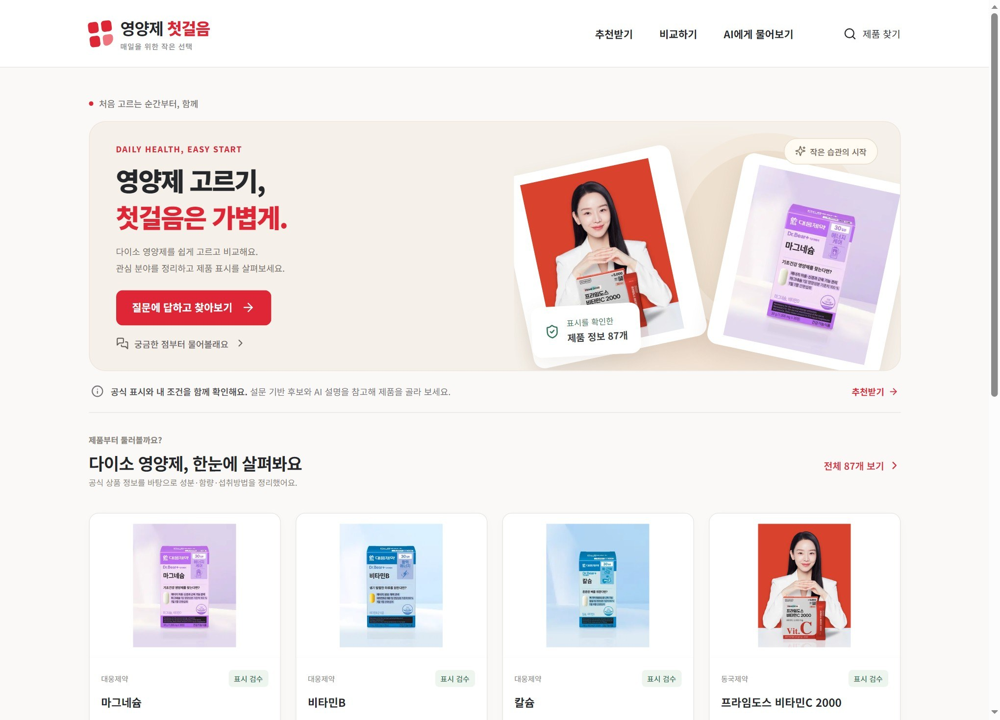
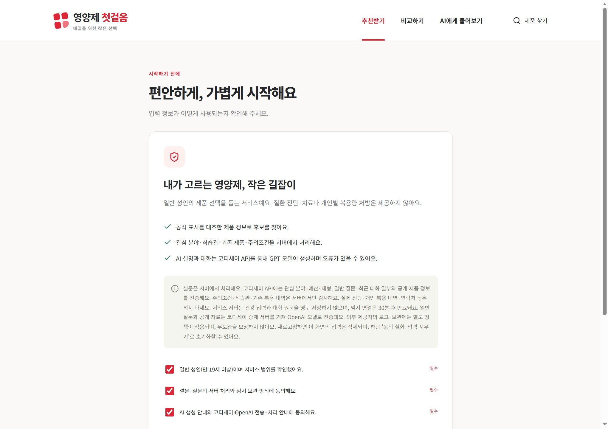
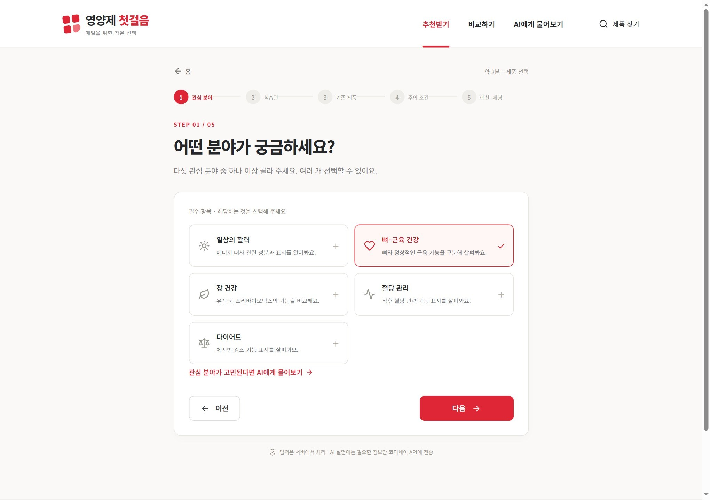
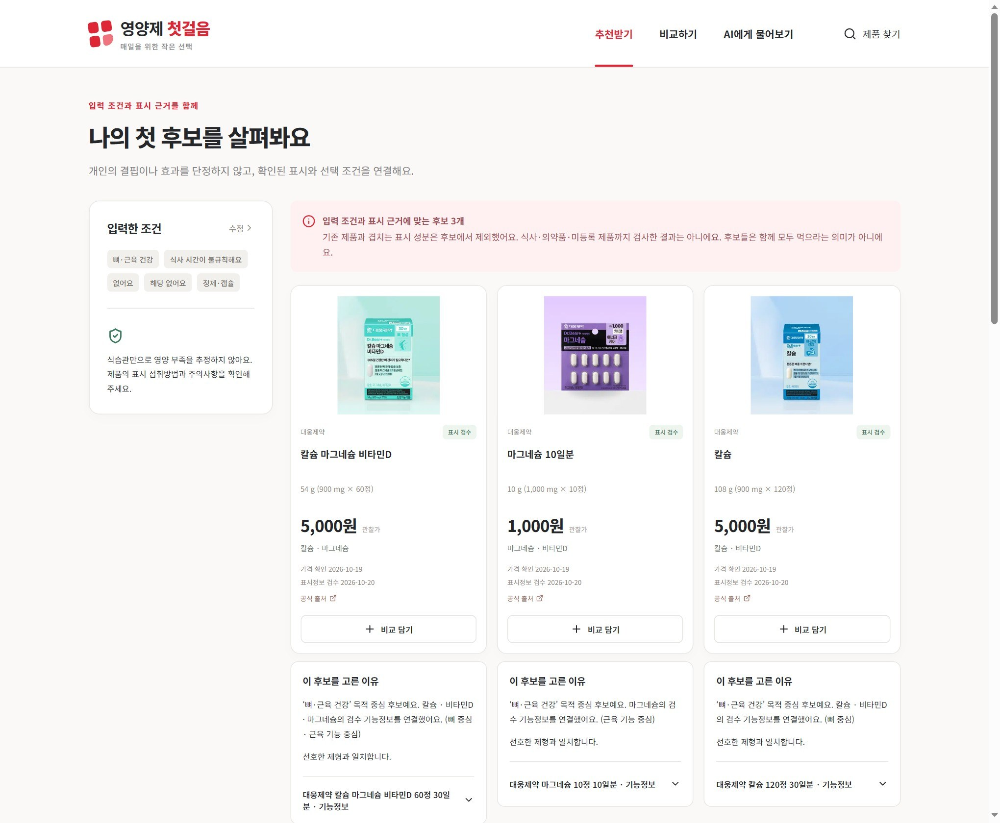
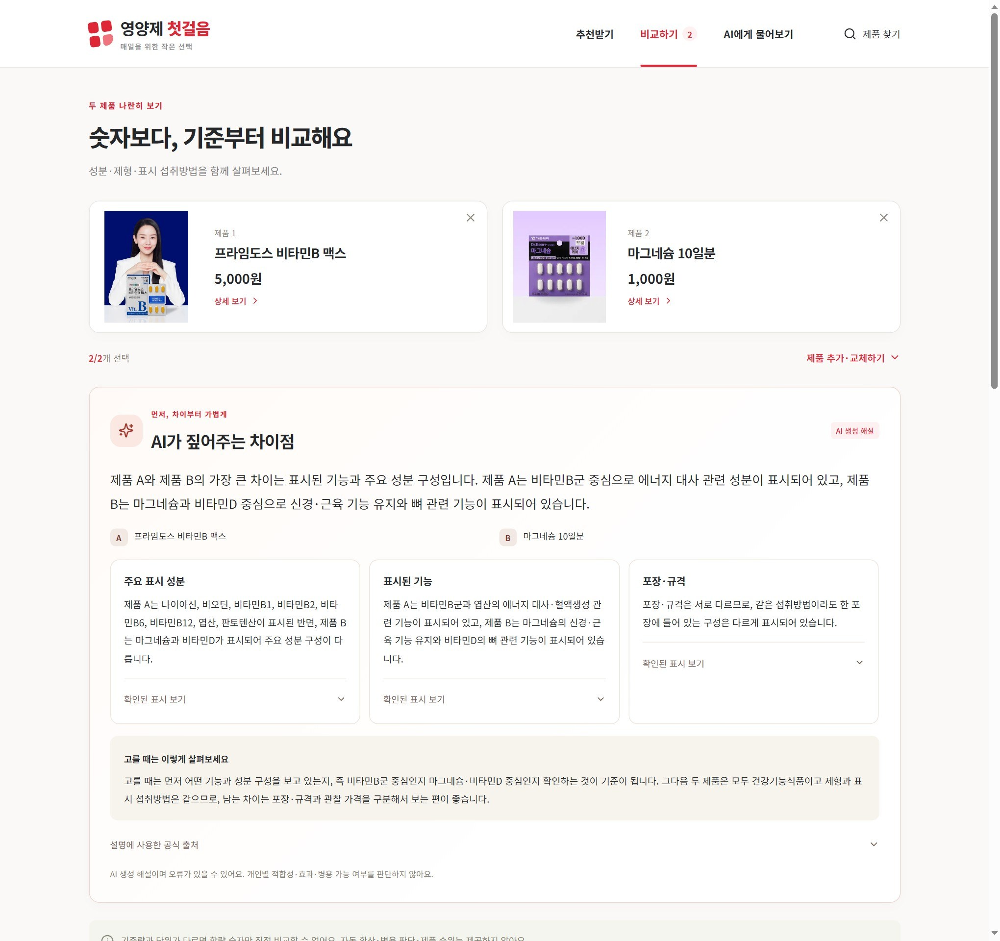
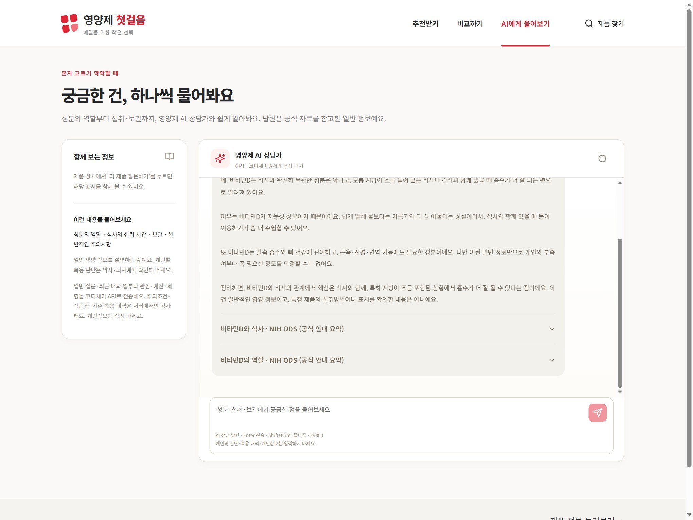
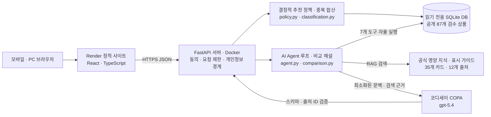

# 영양제 첫걸음 (VitaStep Guide)

> **다이소 영양제를 처음 고르는 성인을 위한 설문 후보 추천 · 두 제품 표시 비교 · 출처 기반 AI 상담 · 제품 찾기 서비스**  
> 공식 라벨 표시정보와 검증된 일반 영양 지식을 검색(RAG)하고, AI Agent가 7개 도구를 자율 호출해 초보자의 제품 탐색과 표시 이해를 돕습니다.

| 바로가기 | 링크 |
|---|---|
| **운영 웹 서비스 (Render)** | **[https://vitastep-guide.onrender.com/](https://vitastep-guide.onrender.com/)** |
| **핵심 제출 문서** | **[최종 제출 문서 목차](docs/final/README.md)** · **[프로젝트 기획서](docs/project-plan.md)** · **[기능 요구 명세서](docs/functional-requirements.md)** · **[발표 자료 PDF (`docs/presentation.pdf`)](docs/presentation.pdf)** |
| **설계 · 검증 · 증빙** | **[시스템 아키텍처](docs/final/architecture.md)** · **[AI 활용 설계](docs/final/ai-design.md)** · **[검증 결과](docs/final/test-results.md)** · **[실사용자 5명 응답 원본](docs/final/evidence/user-test-records.md)** · **[팀원 기여 증빙](docs/final/team-contributions.md)** |
| **소스 저장소** | **[https://github.com/sayknow/M2-1](https://github.com/sayknow/M2-1)** (`production` 브랜치 · 기준 커밋 [`0bc17dc`](https://github.com/sayknow/M2-1/commit/0bc17dca34f3ec6479549248798e76bfcb962064)) |

* **문서 기준일**: `2026-10-24 (KST)` · **운영 AI 모델**: 코디세이 COPA 게이트웨이 기반 **`gpt-5.4`** *(초기 Gemini 프로토타입은 진행 이력으로 보존)*
* **서비스 성격 및 비의료 고지**: 본 프로젝트는 다이소의 공식·제휴 서비스가 아닌 AI 네이티브 학습 프로젝트이며, 의학적 진단·처방·개인별 복용량 조절·병용 안전성 판정을 제공하지 않습니다.

---

## 목차 (Table of Contents)

1. [프로젝트 개요 및 핵심 기능](#1-프로젝트-개요-및-핵심-기능)
   * [1.3 실제 서비스 작동 흐름 및 화면 가이드 (스크린샷)](#13-실제-서비스-작동-흐름-및-화면-가이드-스크린샷)
2. [팀원 및 역할 분담](#2-팀원-및-역할-분담)
3. [기술 스택 및 시스템 아키텍처](#3-기술-스택-및-시스템-아키텍처)
4. [핵심 AI 활용 (AI Agent + RAG)](#4-핵심-ai-활용-ai-agent--rag)
5. [실행 방법 및 평가자 접속 안내](#5-실행-방법-및-평가자-접속-안내)
6. [사용자 피드백 반영 및 개선 결과](#6-사용자-피드백-반영-및-개선-결과)
7. [구현 검증 요약 및 전체 문서 안내](#7-구현-검증-요약-및-전체-문서-안내)

---

## 1. 프로젝트 개요 및 핵심 기능

### 1.1 기획 배경 및 대상 사용자
성분·함량·섭취 기준량의 의미와 비슷한 제품 간 차이를 이해하기 어려운 **영양제 입문 성인(만 19세 이상)**을 대상으로 합니다. 모바일 중심의 **5단계 설문 → 맞춤 후보 추천 → 표시 근거 확인 → 제품 상세 · 비교 · AI 대화** 흐름을 구현했습니다.

* **지원 관심 분야 (5대 분야)**: `일상의 활력` · `뼈·근육 건강` · `장 건강` · `혈당 관리` · `다이어트`

### 1.2 핵심 제공 기능 요약

| 핵심 영역 | 구현 내용 요약 |
|---|---|
| **검수 기반 카탈로그**<br>(87종 공개 · 1종 보류) | 다이소 공식 상품 **88개**를 수집해 원문 표시가 확인된 **87개**를 공개하고, 정량 미기재 상품 **1개**(`600651654`)는 보류(`404`) 처리했습니다. 공식 썸네일 **88개**를 확보해 공개 **87개** 제품에 연결했습니다. |
| **결정적 후보 추천**<br>(최대 3개 후보) | 표시 기능·목적 분류(28개 제품·40개 연결)·기존 섭취 제품·주의조건·예산·제형을 바탕으로 **최대 3개 후보**를 선정합니다. `모름/정보 부족`·`추천 제한`·`빈 결과`를 구분하며, 후보들을 모두 함께 섭취하라는 의미가 아님을 안내합니다. |
| **기존 제품 중복 합산**<br>(`M06`) | 등록된 기존 섭취 제품(최대 10개)과의 기능성 성분 중복 여부를 확인하고, 기준량·단위가 일치할 경우 계산 가능한 **1일 표시 합계**를 산출합니다. |
| **두 제품 표시 비교 · AI 해설**<br>(`M07` · `S01`) | 두 제품의 가격·규격·성분·기준량·섭취법·주의사항 비교표를 제공하고, 선택적으로 양쪽 출처에 기반한 **AI 비교 차이 해설**을 생성합니다. |
| **AI Agent + RAG 상담**<br>(`M03`) | `gpt-5.4`가 7개 도구 중 적합한 도구를 자율 선택하고, 질의마다 읽기 전용 SQLite DB와 공식 영양 지식 카드(35개)·표시 가이드를 검색해 출처(`citations`)와 함께 답변합니다. |
| **무상태 동의 및 개인정보 보호**<br>(`M01` · `M09`) | 가입 계정은 없습니다. `제품 찾기`·`상세`·`표시 비교표`는 동의 없이 공개하며, `추천`·`대화`·`AI 비교 해설`은 이용 안내 3개 항목에 동의한 뒤 30분 만료 임시 세션으로 이용합니다. |

> **데이터 관찰 기준일**: 가격·표시는 주로 `2026-10-19` 관찰, 라벨 검수는 `2026-10-19~20`, 썸네일 사진 확인은 `2026-10-21` 자료입니다. 실시간 매장 가격·재고 연동이나 독립 임상 검증 자료가 아닙니다.

### 1.3 실제 서비스 작동 흐름 및 화면 가이드 (스크린샷)

실제 운영 배포 환경([`https://vitastep-guide.onrender.com/`](https://vitastep-guide.onrender.com/))에서 사용자가 서비스를 이용하는 **6단계 작동 흐름**과 실시간 캡처 화면입니다.

#### Step 01. 홈 화면 및 검수 완료 87개 카탈로그 탐색 (`#/`)
* 첫 방문 시 서비스의 핵심 목적(*"영양제 고르기, 첫걸음은 가볍게"*)과 **검수 완료된 87개 다이소 영양제 미리보기**, **3단계 이용 안내(`내 관심부터` → `표시를 나란히` → `궁금함은 가볍게`)**를 확인합니다.
* 회원가입이나 로그인 없이 상단 `제품 찾기`를 통해 87개 전체 카탈로그를 즉시 조회할 수 있으며, 맞춤 추천을 원할 경우 **`질문에 답하고 찾아보기`** 버튼을 클릭합니다.



#### Step 02. 시작 전 비의료 경계 및 개인정보 처리 3대 동의 (`#/survey/1`)
* 추천이나 AI 상담을 시작하기 전, ① **만 19세 이상 일반 성인 및 비의료·비처방 범위 확인**, ② **설문·질문의 서버 처리 및 30분 임시 세션 보관 동의**, ③ **AI 생성 안내 및 코디세이·OpenAI 전송 안내 동의**의 3가지 필수 항목을 확인합니다.
* 사용자의 주의조건·식습관·기존 복용 제품은 서버 내부에서만 결정론적으로 검사하며 외부 LLM으로 전송하지 않습니다.



#### Step 03. 5단계 맞춤 설문 진행 (`#/survey/1` ~ `#/survey/5`)
* **STEP 01 (관심 분야)**: `일상의 활력` · `뼈·근육 건강` · `장 건강` · `혈당 관리` · `다이어트` 5대 건강 분야 중 관심 항목을 복수 선택합니다.
* **STEP 02 ~ 05**: 평소 식습관 → 현재 복용 중인 기존 다이소 제품(최대 10개 검색·등록, 중복 성분 자동 계산용) → 질환·복용약·임신/수유·알레르기 등 주의조건(안전 게이트) → 선호 예산(`3,000원 이하` / `5,000원 이하`) 및 제형을 차례대로 선택합니다.



#### Step 04. 맞춤 후보 추천 결과 및 표시 근거 확인 (`#/results`)
* 입력 조건과 공식 라벨 기능성 표시를 대조하여 **최대 3개의 추천 후보 카드**를 제시합니다 (기존 복용 제품과 주요 기능성 성분이 겹치는 제품은 후보에서 자동 제외).
* 각 후보 카드마다 **‘이 후보를 고른 이유’**와 펼침형 **공식 라벨 원문 인용(`citations`)**, 그리고 코디세이 `gpt-5.4`가 생성한 **AI 선택 근거 해설**을 함께 확인할 수 있습니다.



#### Step 05. 두 제품 나란히 비교 & AI 핵심 차이 3가지 해설 (`#/compare`)
* 후보 카드 또는 카탈로그에서 **`+ 비교 담기`**로 두 제품을 선택하면, 상단에 **`AI가 짚어주는 차이점`** 카드를 통해 **주요 표시 성분 · 표시된 기능 · 포장·규격**의 3가지 핵심 차이와 선택 기준(*"고를 때는 이렇게 살펴보세요"*)을 요약해 줍니다.
* 하단에는 두 제품의 가격·규격·함량 기준·주요 성분·섭취방법·주의사항을 행 단위로 대조하는 **표시정보 비교표**(`차이만 보기` 스위치 지원)가 제공됩니다.



#### Step 06. 영양제 AI 상담가 챗봇 및 공식 출처 인용 (`#/chat`)
* *"1정당 함량과 1일 섭취량 기준은 뭐가 달라요?"*, *"비타민D는 식사 후에 먹는 게 좋나요?"* 등 초보자가 자주 헷갈리는 질문을 추천 시작 칩 또는 자유 입력(최대 300자)으로 물어볼 수 있습니다.
* AI Agent(`gpt-5.4`)가 7개 도구 중 필요한 도구를 자율 호출하여 **검수 완료 DB(87개 상품)**와 **공식 영양 지식 카드(35개 · NIH ODS 등 12개 출처)**를 검색(RAG)한 뒤, 답변 하단에 **검증된 공식 출처 아코디언**을 함께 표시합니다.



---

## 2. 팀원 및 역할 분담

| 팀원 | 배정 역할 | 주요 담당 업무 | 대표 산출물 및 통합 PR · 커밋 근거 |
|---|---|---|---|
| **이승현** | **주 개발** | 프런트·백엔드·AI 추천 공동 개발 주도, 아키텍처 통합·CI·운영 배포 관리 | 본인 계정 `sayknow`, [`agent.py`](backend/agent.py) · [`policy.py`](backend/policy.py), [PR #3](https://github.com/sayknow/M2-1/pull/3) · [PR #6](https://github.com/sayknow/M2-1/pull/6) |
| **조준수** | **부 개발** | 프런트·백엔드·AI 추천 공동 개발, 목적 분류·비교 해설·검색 구현 및 검증 보조 | [`classification.py`](backend/classification.py) · [`comparison.py`](backend/comparison.py) · [`CompareExplanation.tsx`](frontend/src/CompareExplanation.tsx), [PR #4](https://github.com/sayknow/M2-1/pull/4) · [PR #5](https://github.com/sayknow/M2-1/pull/5) |
| **김재욱** | **AI / 데이터** | 공식 상품 자료 수집·라벨 표시 검수·보류 관리·일반 영양 지식(RAG) 정리 | [DB 설계 기록](docs/product-database.md) · [라벨 검수](docs/product-label-review.md) · [`nutrition-knowledge.json`](backend/nutrition-knowledge.json), [`de683ca`](https://github.com/sayknow/M2-1/commit/de683ca) · [`b1185bf`](https://github.com/sayknow/M2-1/commit/b1185bf) |
| **윤준서** | **기획 / 설계** | 문제 정의·타깃 설정·기능 요구 명세서 및 시스템 아키텍처 문서 설계 | [프로젝트 기획서](docs/project-plan.md) · [기능 요구 명세서](docs/functional-requirements.md) · [아키텍처](docs/final/architecture.md), [`e40d644`](https://github.com/sayknow/M2-1/commit/e40d644) |
| **배창민** | **QA / 피드백** | Must 시나리오 테스트·실사용자 5명 테스트 진행·피드백 5대 개선 정리·진행 기록 | [사용자 피드백](docs/final/user-feedback.md) · [5인 응답 원본](docs/final/evidence/user-test-records.md) · [검증 결과](docs/final/test-results.md), [`1e44b76`](https://github.com/sayknow/M2-1/commit/1e44b76) |

* 상세 문서: **[팀원별 상세 역할·본인 기여 요약 및 증빙 표 (`docs/final/team-contributions.md`)](docs/final/team-contributions.md)**

> **[팀 협업 및 통합 배포 관리 방식]**  
> Render 클라우드 무중단 배포 및 브랜치(`canary → dev → production`) 승격의 안정성을 위해, 저장소의 최종 커밋 및 배포 관리는 주 개발자(이승현) 계정으로 통합·일원화하였습니다. 각 팀원(김재욱, 윤준서, 배창민, 조준수)은 자신의 전담 파트(라벨 데이터 검수, 기획/명세서 설계, 실사용자 QA, 공동 개발)를 독립적으로 수행한 후, 주 개발자를 통해 저장소에 통합 반영하였습니다.

---

## 3. 기술 스택 및 시스템 아키텍처

### 3.1 기술 스택 및 선정 이유

| 구성 영역 | 선택 기술 | 선정 이유 |
|---|---|---|
| **Frontend** | **React · TypeScript · Vite** | 모바일 중심 반응형 화면 구성, 엄격한 API 타입 연결, Render 정적 사이트 배포 |
| **Backend** | **Python · FastAPI · Pydantic** | 데이터 검수 스크립트와 언어 통일, 입력 스키마 검증, 비동기 AI 호출 처리 |
| **Data / RAG** | **SQLite (읽기 전용) + 분류/지식 JSON** | 88개 규모의 검수 DB를 외부 DB 서버 장애 없이 Docker 컨테이너와 함께 배포·버전 관리 |
| **AI / Agent** | **OpenAI Python SDK → COPA → `gpt-5.4`** | 코디세이 제공 키 및 엔드포인트에서의 실제 도구 호출(`tool_calls`) 호환성 검증 |
| **Infra / CI** | **Render (Static + Docker API) · GitHub Actions** | 소규모 안정 운영, 로컬 검증 및 4개 CI 잡 통과 후 단계적 브랜치 승격 |

### 3.2 시스템 아키텍처 다이어그램



### 3.3 주요 소스 코드 구조 및 브랜치 전략

| 계층 | 주요 파일 경로 | 역할 요약 |
|---|---|---|
| **Backend API · 정책** | [`backend/main.py`](backend/main.py), [`backend/policy.py`](backend/policy.py), [`backend/classification.py`](backend/classification.py), [`backend/privacy.py`](backend/privacy.py) | 세션/동의 게이트, 결정적 후보 추천·중복 성분 합산, 목적 분류, 민감 입력 필터링 |
| **AI Agent · RAG** | [`backend/agent.py`](backend/agent.py), [`backend/comparison.py`](backend/comparison.py), [`backend/repository.py`](backend/repository.py), [`backend/knowledge.py`](backend/knowledge.py) | 7개 도구 루프 및 인용 검증, 두 제품 비교 해설·캐시, SQLite·공식 지식 카드 검색 |
| **Frontend UI** | [`frontend/src/App.tsx`](frontend/src/App.tsx), [`frontend/src/CompareExplanation.tsx`](frontend/src/CompareExplanation.tsx), [`frontend/src/services.ts`](frontend/src/services.ts) | 홈·동의·5단계 설문·추천·상세·비교·채팅 화면 및 API 통신 클라이언트 |
| **Data · 검증** | [`data/products/products.sqlite3`](data/products/products.sqlite3), [`scripts/validate_final_docs.py`](scripts/validate_final_docs.py) | 검수 완료 상품 SQLite DB 및 오프라인 데이터/썸네일/문서 무결성 검증 스크립트 |

* 상세 설계 문서: **[시스템 아키텍처](docs/final/architecture.md)** · **[AI 활용 설계와 코드 위치](docs/final/ai-design.md)**
* **브랜치 승격 규칙**: `main`은 초기 프로토타입을 보존하며, 모든 변경은 **`canary → dev → production`** 순서로 승격합니다. ([참여 및 브랜치 보호 규칙](CONTRIBUTING.md) · [보안 및 운영/복구 가이드](docs/final/security-and-operations.md))

---

## 4. 핵심 AI 활용 (AI Agent + RAG)

### 4.1 AI Agent 구조 (7개 도구 자율 호출 루프)
[`backend/agent.py`](backend/agent.py)의 `SupplementAgent`는 사용자의 질문 의도를 파악하여 아래 **7개 Function Calling 도구** 중 필요한 도구를 스스로 선택해 실행합니다 (최대 2라운드, 라운드당 최대 4개 호출).

| 도구 이름 (`function.name`) | 수행 역할 및 검색 대상 |
|---|---|
| `search_nutrition_knowledge` | 공식 자료로 검토한 성분 역할·식사/복용 시간·보관법·일반 주의사항 지식 카드(35개) 검색 |
| `search_products` | 공개 검수 완료 제품(87개)의 이름·브랜드·기능성 성분 키워드 탐색 |
| `get_product_details` | 특정 품번의 검수 표시정보(성분·기준량·섭취법·주의사항) 및 공식 출처 조회 |
| `search_evidence` | 질문 키워드에 따른 제품의 공식 라벨 표시 또는 `함량 vs 기준량` 등 표시 읽기 공식 가이드 검색 |
| `check_overlap` | 사용자가 등록한 기존 섭취 제품 간 기능성 성분 중복 및 계산 가능한 1일 표시 합계 조회 |
| `compare_products` | 두 제품의 서버 표시정보 비교표(가격·규격·성분·섭취법·주의사항) 조회 |
| `recommend_products` | 현재 설문 조건에 대해 서버 결정적 정책(`policy.py`)으로 선정된 후보 및 제한 사유 확인 |

### 4.2 RAG 파이프라인 및 출처 교차 검증 (`sanitize_answer`)
* **질의별 동적 검색**: 고정 텍스트 프롬프트에 의존하지 않고, 질의마다 ① SQLite 검수 뷰(`verified_product_fields`, `verified_product_nutrients`), ② 일반 영양 지식 카드([`backend/nutrition-knowledge.json`](backend/nutrition-knowledge.json), 35개 카드·12개 공식 출처), ③ 표시 읽기 가이드([`backend/label-guides.json`](backend/label-guides.json))를 실시간 검색하여 모델에 주입합니다.
* **할루시네이션 원천 차단**: 모델이 최종 출력한 `citationIds`와 `productIds`가 실제 도구 실행으로 확보한 근거 풀(`source_pool`) 및 허용 후보 목록에 존재하는지 서버에서 전수 검사합니다. 확인되지 않은 출처나 임의 복용량 지시는 에러로 차단합니다.

---

## 5. 실행 방법 및 평가자 접속 안내

### 5.1 평가자 외부 서비스 접속 (설치 불필요)
* **운영 URL**: **[https://vitastep-guide.onrender.com/](https://vitastep-guide.onrender.com/)**
* 별도 로그인 계정은 필요 없습니다. 첫 접속 시 백엔드 컨테이너가 유휴 상태에서 깨어나는 동안 잠시 지연될 수 있으니 화면의 **서버 준비 안내**가 완료된 뒤 진행해 주세요.
* 테스트 시에는 실제 개인 건강정보 대신 가상 성인 선택지를 사용합니다. 화면별 상세 재현 방법은 **[기능 요구 명세서](docs/functional-requirements.md)**를 참조해 주세요.

### 5.2 로컬 개발 환경 설치 및 실행
로컬 실행에는 **Python 3.11 이상**(검증 `3.13`), **Node.js 22.12 이상**(검증 `24`)이 필요합니다.

```sh
# 1. 저장소 루트에서 Python 가상환경 생성 및 고정 의존성 설치
python3 -m venv .venv
.venv/bin/python -m pip install -r backend/requirements.lock

# 2. .env 파일이 없을 때만 예시 파일 복사 후 본인 키 입력
cp -n .env.example .env
```

* 루트 `.env` 파일의 `COPA_API_KEY`에 본인의 코디세이 API 키를 입력합니다 (`COPA_BASE_URL=https://copa.codyssey.kr/v1`, `COPA_MODEL=gpt-5.4`).
* 비밀키는 Git 추적에서 제외되며 프런트엔드 `VITE_` 변수·채팅·로그에 넣지 않습니다. 키가 없어도 공개 카탈로그 조회와 규칙 기반 후보 선정은 동작하며, AI 영역만 설정 필요 안내를 표시합니다.

```sh
# 터미널 1: 백엔드 API 서버 실행 (포트 8000)
.venv/bin/python -m uvicorn backend.main:app --host 127.0.0.1 --port 8000 --no-access-log
```

```sh
# 터미널 2: 프런트엔드 개발 서버 실행 (포트 5173)
cd frontend
npm ci
npm run dev -- --port 5173

# 프로덕션 정적 빌드 미리보기 시:
# npm run build && npm run preview -- --port 4173
```

* 접속 주소: [로컬 개발 화면 (`http://127.0.0.1:5173/`)](http://127.0.0.1:5173/) · [로컬 API 문서 (`http://127.0.0.1:8000/docs`)](http://127.0.0.1:8000/docs)

### 5.3 테스트 및 무결성 검증 명령어

```sh
# 루트: 외부 AI 호출이나 쿼터 소모 없이 실행되는 오프라인 전체 검사
.venv/bin/python -m pytest -q
python3 scripts/validate_product_database.py
python3 scripts/validate_product_thumbnails.py
python3 scripts/validate_final_docs.py

# frontend 디렉터리: 단위 테스트 및 배포 빌드 검증
cd frontend
npm test
npm run build
```

> **실제 운영 API 3회 반복 검증 (주의: 실제 AI 쿼터 소모)**: 기존 제출 증빙 파일을 덮어쓰지 않으려면 반드시 `--report` 경로를 별도로 지정해 실행합니다.
> ```sh
> .venv/bin/python scripts/check_submission.py --run-live \
>   --base-url https://m2-1-api.onrender.com \
>   --report /tmp/m2-1-acceptance-new.json
> ```

---

## 6. 사용자 피드백 반영 및 개선 결과

실제 타깃 성인 5명(`T1`~`T5`, 팀원 제외)을 대상으로 사용성 테스트를 진행하고, 수집된 5가지 핵심 불편 사항을 실제 코드와 운영 배포(`0bc17dc`)에 반영했습니다.
* 상세 문서: **[사용자 피드백과 개선 기록 (`docs/final/user-feedback.md`)](docs/final/user-feedback.md)** · **[실사용자 5명 응답 원본 기록 (`docs/final/evidence/user-test-records.md`)](docs/final/evidence/user-test-records.md)**

| ID | 피드백 주제 (참여자) | 개선 전 → 개선 후 요약 | 반영 커밋 및 근거 |
|---|---|---|---|
| **F01** | 사이트 주소 식별성 (`T1`) | 과제 코드 형태(`m2-1-itfc...`) → 서비스 목적이 드러나는 **`vitastep-guide.onrender.com`** 전환 | [`1e44b76`](https://github.com/sayknow/M2-1/commit/1e44b76) |
| **F02** | AI 질문 범위 확대 (`T2`) | 개별 제품 표시 검색 한정 → **일반 영양 지식 카드(35개) + 제품 표시 검색** 이중 구조로 확장 | [`b1185bf`](https://github.com/sayknow/M2-1/commit/b1185bf) |
| **F03** | 첫 시작 질문 오류 (`T3`) | *‘함량과 기준량의 차이’* 질문 시 근거 없음 오류 → 제품 선택 없이도 **표시 읽기 공식 가이드** 즉시 인용 | [`c8fa914`](https://github.com/sayknow/M2-1/commit/c8fa914) |
| **F04** | 활력 추천 납득도 (`T4`) | 넓은 성분 연결로 마그네슘 등 혼재 → **비타민 B군 직접 목적(`direct`) 후보 우선** 및 관련 성분 분리 | [`b75f847`](https://github.com/sayknow/M2-1/commit/b75f847), [PR #4](https://github.com/sayknow/M2-1/pull/4) |
| **F05** | 포장 변형 중복 추천 (`T5`) | 용량·포장만 다른 동일 제품군 반복 노출 → **성분·제형·섭취법 기준 대표 후보 묶기** 및 미충족 목적 우선 | [`b75f847`](https://github.com/sayknow/M2-1/commit/b75f847), [`policy.py`](backend/policy.py) |

---

## 7. 구현 검증 요약 및 전체 문서 안내

### 7.1 검증 결과 및 제출 준비 상태

| 점검 영역 | 확인 결과 | 상세 근거 문서 |
|---|---|---|
| **핵심 기능 구현** | **Must 8개(`M01`~`M07`, `M09`)** 및 **Should 1개(`S01`)** 전체 구현 완료 | [기능 요구 명세서](docs/functional-requirements.md) |
| **로컬 자동화 테스트** | 백엔드 **159개** · 프런트엔드 **15개** 테스트 통과, 정적 빌드 성공 | [검증 결과 상세](docs/final/test-results.md) |
| **데이터 무결성** | **14,587개** 검증 항목 통과, 공식 썸네일 **88개** 확보 · 공개 **87개** 연결 | [데이터 검증 보고서](docs/data-validation.md) |
| **실제 운영 API 3회 검증** | `M04`(추천 AI 설명) **2/3 성공**, 나머지 7개 Must 및 `S01` **3/3 성공** | [`acceptance-api.json`](docs/final/evidence/acceptance-api.json) |
| **브라우저 E2E 확인** | 동의·설문 흐름(`M01`·`M02`) 브라우저 3/3 통과 및 주요 화면 캡처 완료 | [`acceptance-browser.json`](docs/final/evidence/acceptance-browser.json) |
| **실사용자 5명 · 피드백 개선** | 타깃 성인 **5명(`T1`~`T5`) 응답 원본 기록** 및 **5대 개선(`F01`~`F05`)** 반영 완료 | [5인 응답 원본](docs/final/evidence/user-test-records.md) · [피드백 문서](docs/final/user-feedback.md) |
| **팀원 5인 전원 기여** | 5인 전원 역할 분담, 본인 기여 요약 및 담당 산출물·PR/커밋 연결 완료 | [팀원 역할과 기여](docs/final/team-contributions.md) |
| **개인정보 · AI 윤리** | AI 생성 표시, 사전 동의·철회, 서버 영구 미저장(30분 메모리 세션), 민감정보 필터링 | [보안·운영 가이드](docs/final/security-and-operations.md) |
| **발표 자료 (12페이지 PDF)** | 16:9 와이드스크린 **12페이지 발표 PDF 제작 및 렌더링 검수 완료** | **[`docs/presentation.pdf`](docs/presentation.pdf)** · [슬라이드 구성 안내](docs/final/presentation-outline.md) |

> **증빙 분리 원칙**: 개발자 QA 반복 테스트([`test-results.md`](docs/final/test-results.md))와 실제 타깃 사용자 5명 피드백([`user-test-records.md`](docs/final/evidence/user-test-records.md))은 구분하여 기록했습니다. 서면 심사용 발표 자료 PDF([`docs/presentation.pdf`](docs/presentation.pdf))까지 모두 제작·연결 완료했으며 시연 영상은 생략합니다.

### 7.2 전체 제출 문서 네비게이션

| 번호 | 문서명 | 핵심 내용 |
|---|---|---|
| **01** | **[최종 제출 문서 목차 (`docs/final/README.md`)](docs/final/README.md)** | 과제 평가 요건(`G1`~`G7`) 대조표 및 전체 문서 읽는 순서 안내 |
| **02** | **[프로젝트 기획서 (`docs/project-plan.md`)](docs/project-plan.md)** | 문제 정의, 타깃, 사용자 흐름, 데이터 품질, 기술 선정 이유, 추진 일정 |
| **03** | **[기능 요구 명세서 (`docs/functional-requirements.md`)](docs/functional-requirements.md)** | Must 8개·Should 1개 상세 명세, 비기능 요구(`N01`~`N07`), AI 분담 매트릭스 |
| **04** | **[시스템 아키텍처 (`docs/final/architecture.md`)](docs/final/architecture.md)** | 화면/API/DB/외부 AI 데이터 경계, API 계약 요약, 배포 및 한계 |
| **05** | **[AI 활용 설계 (`docs/final/ai-design.md`)](docs/final/ai-design.md)** | AI Agent 7개 도구 루프, RAG 검색 범위, 추천 정책, 비교 해설 설계 |
| **06** | **[검증 결과 (`docs/final/test-results.md`)](docs/final/test-results.md)** | 로컬 자동화 테스트, 운영 API 3회 반복 검증 및 실패 원인 분석 |
| **07** | **[사용자 피드백과 개선 (`docs/final/user-feedback.md`)](docs/final/user-feedback.md)** | 5대 개선 항목(`F01`~`F05`) 전후 비교 및 커밋 근거 |
| **08** | **[실사용자 5명 응답 원본 (`docs/final/evidence/user-test-records.md`)](docs/final/evidence/user-test-records.md)** | 참여자 `T1`~`T5` 타깃 적격 사유, 6개 문항 응답 원문 및 미반영 의견 사유 |
| **09** | **[팀원 역할과 기여 (`docs/final/team-contributions.md`)](docs/final/team-contributions.md)** | 5인 역할 분담, 통합 배포 원칙, 개인별 본인 기여 요약 및 산출물/PR 링크 |
| **10** | **[진행 기록 (`docs/final/progress.md`)](docs/final/progress.md)** | 일자별 실제 Git 커밋·PR 및 주요 기술적 의사결정 이력 |
| **11** | **[보안 및 운영 (`docs/final/security-and-operations.md`)](docs/final/security-and-operations.md)** | 동의·개인정보 경계, 비밀키 관리, 장애 대응 및 롤백 절차 |
| **12** | **[발표 자료 PDF (`docs/presentation.pdf`)](docs/presentation.pdf)** · **[구성 안내](docs/final/presentation-outline.md)** | 12페이지 서면 심사용 발표 PDF 완비 ([동일 사본 `docs/final/presentation.pdf`](docs/final/presentation.pdf)) |
