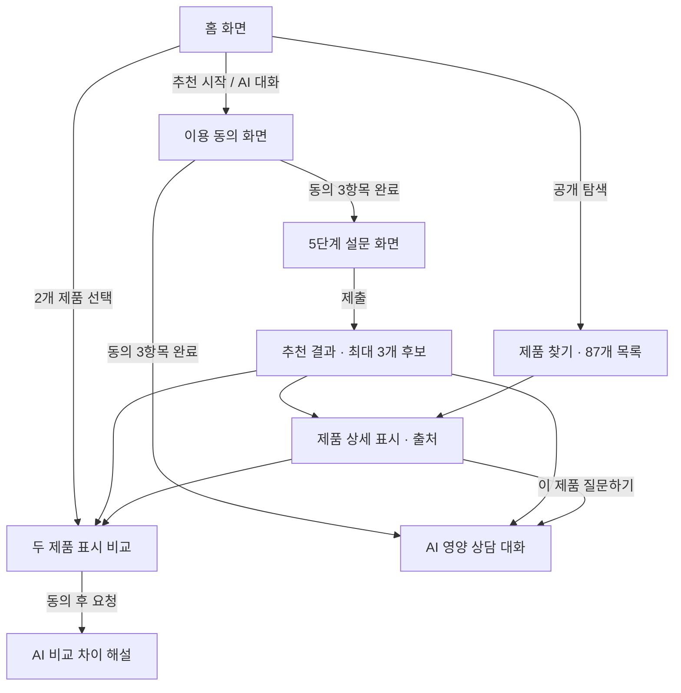

# 기능 요구 명세서 — 최종 구현 기준

> **문서 기준일**: 2026-10-24 (KST) · **구현 기준 커밋**: [`0bc17dc`](https://github.com/sayknow/M2-1/commit/0bc17dca34f3ec6479549248798e76bfcb962064) · **운영 브랜치**: `production`  
> **바로가기**: [운영 서비스](https://vitastep-guide.onrender.com/) · [최종 제출 목차](final/README.md) · [프로젝트 기획서](project-plan.md) · [시스템 아키텍처](final/architecture.md) · [AI 활용 설계](final/ai-design.md) · [검증 결과](final/test-results.md)

---

## 1. 개요 및 요구사항 범위

* **서비스 목적**: 다이소 영양제를 처음 고르는 일반 성인이 검수된 공식 표시정보를 바탕으로 **5단계 설문 후보 추천 · 두 제품 표시 비교 · 출처 기반 AI 상담 대화**를 이용할 수 있도록 지원합니다.
* **기능 요구사항 구성**:
  * **Must 요구사항 (필수 8개)**: `M01`, `M02`, `M03`, `M04`, `M05`, `M06`, `M07`, `M09` — 모두 구현 완료
  * **Should 요구사항 (선택 1개)**: `S01` (AI 두 제품 비교 해설) — 구현 완료
  * **제외 번호 안내 (`M08`)**: `M08`은 초기 외부 쇼핑몰 대안 제품 추천 구상이므로 번호만 비워 두고 구현 및 평가 범위에서 제외합니다. 하위 확인 항목을 숨겨 Must 개수를 임의로 축소하지 않으며, 각 기능의 기대 결과 전체를 검증 기준으로 삼습니다.

---

## 2. 대상 사용자 및 입력 명세

### 2.1 사용자 및 데이터 기본 경계
* **대상 사용자**: 만 19세 이상 일반 성인 (별도 회원가입·로그인 계정은 사용하지 않으며, 보호 기능은 30분 만료 임시 세션 토큰으로 제어)
* **공개 상품 범위**: 수집 88개 중 표시 검수를 통과한 **87개 제품**만 공개·검색·비교·추천에 사용합니다. 보류 제품(`600651654`)은 조회 시 `404`를 반환합니다.
* **민감 정보 입력 제한**: 구체적인 병명, 처방 의약품명, 병원 검사 수치, 실명, 연락처 등은 설문으로 입력받지 않으며, 채팅에 입력될 경우 서버([`privacy.py`](../backend/privacy.py))에서 감지하여 외부 AI로 전송하지 않고 안내합니다.

### 2.2 5단계 설문 입력 계약 ([`backend/models.py`](../backend/models.py))

| 단계 | 항목명 | 필수 여부 | 허용 선택지 및 입력 규칙 |
|---|---|---|---|
| **STEP 01** | **관심 분야** (`interests`) | **필수** (복수 선택) | `일상의 활력`, `뼈·근육 건강`, `장 건강`, `혈당 관리`, `다이어트` *(이전 '눈 건강', '다양한 성분 보기', '잘 모르겠어요'는 지원하지 않으며 요청 시 `422` 차단)* |
| **STEP 02** | **평소 식습관** (`habits`) | **필수** (복수 선택) | `식사 시간이 불규칙해요`, `채소·과일이 적은 편이에요`, `다양하게 먹는 편이에요`, `잘 모르겠어요` *(`잘 모르겠어요`는 다른 항목과 동시 선택 불가)* |
| **STEP 03** | **기존 섭취 제품** (`existing`, `productIds`) | **필수** (단일 상태) | `없어요`, `잘 모르겠어요`, `목록에 없어요`, `제품 선택` *(`제품 선택` 시 공개 87개 DB에서 **1~10개** 품번 선택 필수)* |
| **STEP 04** | **주의 조건** (`cautions`, `specialtyConfirmed`) | **필수** (복수 선택) | `질환 진단·치료·의약품 복용 중이에요`, `임신·수유 중이에요`, `알레르기를 확인해야 해요`, `해당 없어요`, `잘 모르겠어요` *(`혈당 관리` 또는 `다이어트` 선택 시 안내 범위 확인 `specialtyConfirmed=true` 체크 필요)* |
| **STEP 05** | **예산 및 선호 제형** (`budget`, `form`) | **선택** (건너뛰기 가능) | • **예산**: `3,000원 이하`, `5,000원 이하`, `상관없어요` (또는 빈 값) • **제형**: `정제·캡슐`, `구미·츄어블`, `분말·포`, `필름·액상`, `상관없어요` (또는 빈 값) |

---

## 3. 화면 구성 및 이동 흐름

| 화면명 | 주요 구성 및 사용자 조작 | 이동 경로 및 예외·비정상 상태 처리 |
|---|---|---|
| **홈** | 추천 시작, 제품 찾기, 두 제품 비교, AI 대화 진입 카드 및 대표 제품 미리보기 | 보호 기능(추천·대화·AI 비교 해설) 진입 시 미동의 상태면 이용 동의 화면으로 연결 |
| **이용 동의** | 성인 확인·서버 처리/임시 보관·AI 생성 및 외부 전송 안내 3개 필수 체크박스 | 3개 모두 체크해야 진행 가능. 하단 `동의 철회·입력 지우기` 클릭 시 세션 즉시 폐기 및 초기화 |
| **5단계 설문** | 단계 표시기(Stepper), 선택 카드, 이전/다음 이동, 5단계 선택 항목 건너뛰기 | 필수 항목 누락 시 경고 표시 및 다음 이동 차단, 이전 단계 이동 시 기존 선택값 유지, 관심 분야 고민 시 AI 대화 연결 |
| **추천 결과** | 최대 3개 후보 카드, 후보별 선정 이유·표시 근거 펼침, 기존 제품 중복 성분 합계, AI 선택 근거 해설 | 상세·비교·대화로 연동. 주의조건 해당(`restricted`)·정보 부족(`insufficient`)·후보 없음(`empty`) 안내 분리. AI 실패 시에도 규칙 후보는 정상 표시 |
| **제품 찾기 · 상세** | 키워드 검색, 유형 필터(`전체`/`건강기능식품`/`일반식품`), 공식 사진, 관찰 가격, 영양정보·기능정보·섭취법·주의사항·원재료·출처 URL | 미등록 품번이나 보류 제품(`600651654`) 접근 시 찾을 수 없음(`404`) 안내 및 목록 복귀 버튼 제공 |
| **두 제품 비교** | 비교 슬롯 2개, 제품 검색·추가·교체, 항목별 표시 비교표, `차이만 보기` 토글, 선택적 AI 비교 해설 | 3번째 제품 담기 시 기존 슬롯 교체 모달 제공. AI 해설 생성 실패 시에도 공개 표시 비교표는 그대로 유지 |
| **AI 영양 상담 대화** | 추천 시작 질문 칩, 자유 질문 입력(300자 이내), 출처 아코디언 펼침, 관련 제품 카드, 재시도 버튼 | 제품 상세에서 진입 시 해당 제품 문맥 자동 연결. 근거 부족 시 질문 구체화 안내, 개인 처방/진단 질문은 로컬 안전 안내 반환 |

---

## 4. 기능 요구사항 상세 명세 (Must 8개 · Should 1개)

### 4.1 기능 요구사항 전체 요약

| ID | 우선순위 | 기능명 | 구현 여부 | 핵심 검증 결과 |
|---|---|---|---|---|
| **M01** | **Must** | 이용 범위·성인·정보 처리·AI 동의 및 철회 | 구현 완료 | API 3/3 통과 · 브라우저 화면 3/3 통과 |
| **M02** | **Must** | 5단계 설문 입력 및 단계별 유효성 검증 | 구현 완료 | API 선택지 검증 3/3 통과 · 브라우저 화면 3/3 통과 |
| **M03** | **Must** | AI Agent · RAG 기반 영양 상담 대화 | 구현 완료 | 실제 GPT(`gpt-5.4`) API 도구 호출·출처 인용 3/3 통과 |
| **M04** | **Must** | 조건 및 목적 분류 기반 맞춤 후보 추천 | 구현 완료 | 실제 GPT API 대표 활력 사례 2/3 통과 (후보 규칙은 3/3 일치) |
| **M05** | **Must** | 검수 제품 상세 표시정보 및 공식 출처 조회 | 구현 완료 | 공개 조회 및 보류 상품(`600651654`) `404` 차단 API 3/3 통과 |
| **M06** | **Must** | 등록 기존 제품의 표시 성분 중복 및 일일 합계 검사 | 구현 완료 | 마그네슘 중복 합산(`630 mg`) 등 API 3/3 통과 |
| **M07** | **Must** | 두 제품 표시정보 나란히 비교 및 차이 필터링 | 구현 완료 | 기준량·함량 비교 및 동일 품번 중복 선택 `422` 차단 API 3/3 통과 |
| **M09** | **Must** | 추천 제한·정보 부족·외부 AI 실패 경계 및 안전 안내 | 구현 완료 | 제한·모름·범위 미확인 차단 및 외부 AI 미호출 API 3/3 통과 |
| **S01** | **Should** | 두 제품 표시 기반 AI 비교 차이 해설 및 캐시 | 구현 완료 | 실제 GPT 생성(1회) 및 메모리 캐시(2회) API 3/3 통과 |

---

### 4.2 기능별 상세 명세 및 화면 재현 방법

| ID · 기능명 | 화면에서의 재현 및 확인 방법 | 기대 결과 (수락 기준) | 핵심 구현 코드 및 증빙 |
|---|---|---|---|
| **M01 [Must]** 이용 범위·성인·정보 처리·AI 동의 | 1. 홈에서 `추천받기` 또는 `AI에게 물어보기` 진입 2. 체크박스 미선택 상태로 진행 클릭 시 차단 확인 3. 필수 안내 3개 모두 체크 후 시작 4. 하단 푸터 `동의 철회·입력 지우기` 클릭 | • 미동의 상태에서 보호 API 호출 시 `401`/`400` 차단 • 동의 완료 시 30분 만료 임시 세션 토큰 발급 • 동의 철회 시 화면의 설문·대화 입력 즉시 초기화 및 기존 서버 세션 무효화 | [`backend/main.py`](../backend/main.py), [`services.ts`](../frontend/src/services.ts), [`App.tsx`](../frontend/src/App.tsx) 증빙: API 3/3 · 브라우저 3/3 |
| **M02 [Must]** 5단계 설문 및 입력 검증 | 1. 1단계 관심 분야 미선택 상태로 `다음` 클릭 2. `일상의 활력` 선택 후 다음·이전 이동 반복 3. 식습관 선택 → 기존 제품 `없어요` → 주의조건 `해당 없어요` → 5단계 예산 선택 또는 `건너뛰기` | • 필수 항목 누락 시 다음 단계 진행 차단 및 오류 문구 표시 • 이전 단계로 돌아가도 기존 선택값 유지 • `없어요`/`잘 모르겠어요` 배타 선택 정상 작동, 5단계 선택 항목 생략 가능 | [`backend/models.py`](../backend/models.py), [`domain.ts`](../frontend/src/domain.ts), [`App.tsx`](../frontend/src/App.tsx) 증빙: API 3/3 · 브라우저 3/3 |
| **M03 [Must]** AI Agent · RAG 영양 상담 대화 | 1. `AI 대화` 화면에서 시작 질문 *‘함량과 기준량의 차이가 궁금해요’* 클릭 후 출처 펼침 확인 2. 일반 영양 질문 입력 후 출처 확인 3. 제품 상세에서 `이 제품 질문하기` 진입 후 질문 | • 실제 `gpt-5.4`가 7개 도구 중 적합한 검색 도구를 자율 선택·실행(`toolTrace`) • 일반 영양 지식(35개 카드)·표시 읽기 가이드·제품 표시 DB를 구분해 검색 후 공식 출처 인용(`citations`) • 근거 부족이나 개인 처방 요청은 추측 없이 안전 안내 반환 | [`backend/agent.py`](../backend/agent.py), [`repository.py`](../backend/repository.py), [`knowledge.py`](../backend/knowledge.py), [`label_guide.py`](../backend/label_guide.py) 증빙: 실제 GPT API 3/3 |
| **M04 [Must]** 조건 기반 맞춤 후보 추천 | 1. `일상의 활력` · 기존 `없어요` · 주의 `해당 없어요` · `5,000원 이하` · 제형 무관으로 설문 제출 2. 다른 4개 관심 분야 및 예산/제형 조합 변경 확인 3. `혈당 관리`/`다이어트` 범위 확인 체크 전후 비교 | • 서버 규칙으로 검수 표시 기반 **최대 3개 후보** 선정 및 후보별 선정 이유·원문 근거 표시 • `일상의 활력` 선택 시 비타민 B군 직접 목적 후보(`600000129`, `601678603`, `613602132`) 우선 선정 • 용량·포장만 다른 변형 제품 중복 제거, 충족 못한 관심 분야(`missingInterests`) 명확히 고지 • 억지로 3개를 채우지 않으며, 후보들을 모두 함께 섭취하라는 지시 없음 | [`backend/policy.py`](../backend/policy.py), [`classification.py`](../backend/classification.py), [추천 정책 문서](recommendation-policy-v2.md) 증빙: 실제 GPT API 2/3 (규칙 후보 선정은 3/3 일치) |
| **M05 [Must]** 검수 제품 상세 및 공식 출처 | 1. `제품 찾기`에서 품번 `600000128` 또는 `600000147` 검색·선택 2. 주요 성분·전체 영양정보·기능정보·섭취방법·주의사항·원재료·출처 확인 3. 보류 품번 `600651654` 주소로 접근 | • 공식 썸네일 사진, 관찰 가격 및 확인일, 규격, 기준량별 함량, 섭취법, 주의/알레르기/보관법, 다이소몰 공식 출처 링크 표시 • 미등록 품번이나 보류 제품(`600651654`)은 조회 불가(`404`) 처리 | [`backend/repository.py`](../backend/repository.py), [`App.tsx`](../frontend/src/App.tsx) 증빙: API 3/3 |
| **M06 [Must]** 등록 기존 제품 성분 중복 검사 | 1. 설문 3단계 `제품 선택`에서 마그네슘 함유 제품 `600000128`과 `600000270`을 함께 체크 후 제출 2. 결과 화면 상단 `기존 제품에서 겹치는 성분` 섹션 확인 | • 중복된 기능성 성분(`마그네슘`) 목록과 각 제품의 함량·기준량 표시 • 1일 섭취 기준과 단위를 일치시킬 수 있는 경우 **하루 표시 합계(`630 mg`)** 산출 • 기존 제품과 겹치는 성분의 새 후보는 자동 추천에서 제외하며, 안전 상한 판정이 아님을 명시 | [`backend/policy.py`](../backend/policy.py) 증빙: API 중복 합산 3/3 |
| **M07 [Must]** 두 제품 표시정보 나란히 비교 | 1. 품번 `600000128`과 `600000147`을 비교함에 담고 `비교` 화면 이동 2. `차이만 보기` 스위치 토글 3. 3번째 제품을 담아 슬롯 교체 모달 확인 | • 가격·규격·제형·성분별 함량(기준량 포함)·섭취방법·주의사항을 나란히 대조 • 기준량(예: `1일 1정` vs `1일 4정`)이나 단위가 다르면 단순 수치 우열로 해석하지 않도록 안내 • 동일 제품 2개 비교 요청 시 `422` 에러로 차단 | [`backend/repository.py`](../backend/repository.py), [`App.tsx`](../frontend/src/App.tsx) 증빙: API 3/3 · 중복 선택 `422` |
| **M09 [Must]** 제한·정보 부족·실패 안전 경계 | 1. 설문 4단계에서 `임신·수유 중` 또는 `잘 모르겠어요` 선택 후 제출 2. 3단계 `목록에 없어요` 또는 혈당/다이어트 범위 미확인 제출 3. 네트워크/AI 오류 시 재시도 UI 확인 | • 주의조건 해당 시 `restricted`(전문가 상담 안내), 모름/목록 밖/범위 미확인 시 `insufficient`(해당 설문 단계 복귀 경로)로 명확히 구분 • `restricted`/`insufficient` 상태에서는 외부 AI 호출을 수행하지 않음(`not_requested`) • AI 설명 생성이 실패하더라도 규칙 기반 추천 후보나 공개 비교표는 정상 표시 | [`backend/privacy.py`](../backend/privacy.py), [`main.py`](../backend/main.py), [`connection.ts`](../frontend/src/connection.ts) 증빙: 제한 API 3/3 · 자동 테스트 검증 |
| **S01 [Should]** AI 두 제품 비교 차이 해설 | 1. 서로 다른 두 제품(`600000129`, `600000128`) 비교 화면에서 동의 후 AI 해설 확인 2. 한쪽 제품을 다른 제품으로 교체 후 새 해설 확인 | • 한 줄 요약, 핵심 표시 차이(최대 3개), 선택 시 살펴볼 기준, 양쪽 제품의 실제 출처(`citations`) 제공 • 동일 조합 재요청 시 서버 메모리 캐시(`cached=true`) 응답, 제품 변경 시 이전 해설 즉시 숨김 • AI 해설 실패 시에도 하단 공개 표시 비교표는 독립적으로 유지 | [`backend/comparison.py`](../backend/comparison.py), [`CompareExplanation.tsx`](../frontend/src/CompareExplanation.tsx) 증빙: 실제 GPT API 3/3 (생성 1회 · 캐시 2회) |

---

## 5. 비기능 요구사항 (Non-Functional Requirements)

| ID | 항목 | 요구사항 및 구현·검증 기준 |
|---|---|---|
| **N01** | **반응형 UI 및 가독성** | 모바일 화면을 우선 고려한 카드 레이아웃, 단계형 설문, 요약 후 펼침(`
`) 구조 및 명확한 버튼·레이블 적용 (데스크톱 브라우저 호환 포함, 단 전체 WCAG 공인 인증을 의미하지는 않음) |
| **N02** | **검증 가능한 표시 데이터** | 모든 상품에 공식 원문 URL, 관찰일, 검수일, 함량 기준량 및 단위를 명시하고 미확인 값과 `0`을 엄격히 구분. 오프라인 스크립트(`validate_product_database.py`)로 14,587개 데이터 검증 항목 통과 |
| **N03** | **개인정보 최소화 및 무상태성** | 이용 동의 전 보호 API(`401`) 차단, 건강 설문·대화 원문의 서버 DB 영구 저장 금지, 30분 만료 메모리 세션 및 즉시 철회(`DELETE /api/sessions/current`), 외부 AI 전송 시 주의조건·식습관·기존 제품 목록 제외 |
| **N04** | **비밀키 및 보안 관리** | `COPA_API_KEY` 등 비밀값은 백엔드 서버 환경변수에서만 로드하며 `.env` Git 추적 제외, 프런트엔드(`VITE_`) 번들·로그·채팅 응답에 키 노출 원천 차단, 모든 API 응답에 `Cache-Control: no-store` 및 `X-Content-Type-Options: nosniff` 적용 |
| **N05** | **실패 격리 및 요청 제어** | Render 슬립 기동 대기 안내(`connection.ts`), AI 호출 타임아웃(기본 45초), 세션당 분당 10회 요청 제한(`429`), 프로세스 내 동시 AI 실행 세마포어 제어 ([보안·운영 문서](final/security-and-operations.md) 참조) |
| **N06** | **유지보수성 및 버전 추적** | 잠금 의존성(`requirements.lock`, `package-lock.json`), GitHub Actions CI 4개 잡 자동 검증, `canary → dev → production` 승격 규칙, 정책(`2026-10-23.2`)·분류(`2026-10-23.3`)·동의(`2026-10-23.copa.1`)·비교(`2026-10-23.compare.2`) 버전 명시 |
| **N07** | **과장 방지 및 AI 윤리** | 모든 AI 생성 영역에 AI 생성 안내 및 한계 문구 표시, 효능 보장·치료·개인 용량 처방 금지, AI 장애 시 가짜 샘플 답변을 실제 AI 응답처럼 위장해 출력하지 않음 |

---

## 6. AI 활용 및 서버 규칙 분담 명세

단순 프롬프트 호출에 의존하지 않고, **안전과 정확성이 필수적인 영역은 서버의 결정적 규칙(Deterministic Policy)**이 처리하며 **AI Agent와 RAG는 검증된 범위 내 설명과 근거 연결**을 담당합니다.

| 기능 영역 | 서버 결정적 규칙의 역할 (`policy.py` / `repository.py`) | AI (Agent · RAG · LLM)의 역할 (`agent.py` / `comparison.py`) | 사후 검증 및 안전장치 (`sanitize_answer`) |
|---|---|---|---|
| **맞춤 후보 추천 (`M04`)** | 주의조건·모름 차단, 기존 섭취 제품과 성분 중복 제외, 28개 분류 상품 중 목적·예산·제형 필터링으로 **최대 3개 후보 확정** | 확정된 후보 범위 안에서 `get_product_details` 등 도구를 호출해 후보 선정 이유와 표시 확인점을 쉬운 한국어로 설명 | 후보 밖 제품(`productIds`) 언급 시 차단, 실제 조회한 후보의 출처(`citationIds`)가 아니면 `AI_POLICY_MISMATCH`로 거부 |
| **영양 상담 대화 (`M03`)** | 개인정보·질환·위험 질문 사전 필터링(`privacy.py`), 설문 문맥 정제(민감 필드 제거 후 관심·예산·제형만 전달) | 7개 도구 중 질문 의도에 맞는 도구를 자율 선택(최대 2라운드)하여 일반 영양 지식·표시 가이드·제품 DB를 검색(RAG) 후 답변 생성 | 최소 1개 이상의 실제 검색 출처 ID 필수, 허위 URL·코드블록·하루 복용 횟수/정량 지시 패턴 발견 시 응답 차단 |
| **두 제품 비교 (`M07`, `S01`)** | 두 제품의 가격·규격·성분·기준량·섭취법·주의사항 비교 행(`rows`)과 사실 데이터를 정확히 생성 | 서버가 제공한 두 제품의 표시 사실만 바탕으로 한 줄 요약, 핵심 차이(최대 3개), 선택 기준 해설 생성 | 양쪽 제품의 출처 ID가 모두 포함되었는지 검증, '더 우수함/효능 우위/원재료 전체 동일' 등 금지 표현 정규식 차단 |
| **성분 중복 검사 (`M06`)** | 성분 별칭 정규화(`셀레늄`=`셀렌`), `1일 섭취량` 기준 여부 및 단위(`mg`, `μg`, `g`, `IU`) 일치 확인 후 정확한 일일 표시 합계 산출 | 필요 시 대화에서 `check_overlap` 도구를 호출하여 서버가 계산한 중복 성분 결과를 인용해 설명 | 단위나 섭취 기준량이 불일치할 경우 임의 환산·합산 금지, 병용 안전성 확정 표현 금지 |

---

## 7. 평가자 재현 가이드

1. **접속 및 초기 대기**: [운영 서비스(`https://vitastep-guide.onrender.com/`)](https://vitastep-guide.onrender.com/)에 접속합니다. 별도 로그인 계정은 필요 없습니다. 백엔드가 유휴 상태에서 깨어나는 중이라면 화면의 서버 준비 안내가 완료될 때까지 잠시 기다립니다.
2. **사전 동의 및 가상 입력**: 추천·대화·AI 비교 해설 진입 시 3개 필수 안내에 동의합니다. 테스트 시에는 실제 개인 건강정보 대신 위 표에 안내된 **가상 성인 선택지와 예시 품번(`600000128`, `600000147`, `600000129`, `600000270`, 보류 품번 `600651654`)**을 사용합니다.
3. **반복 확인 기준**: 각 기능을 3회 실행하여 2회 이상 기대 결과가 재현되는지 확인합니다. 실제 운영 서버를 대상으로 수행한 HTTP API 3회 반복 검증 및 브라우저 검증 상세 로그는 [검증 결과 문서](final/test-results.md)에서 확인할 수 있습니다.
