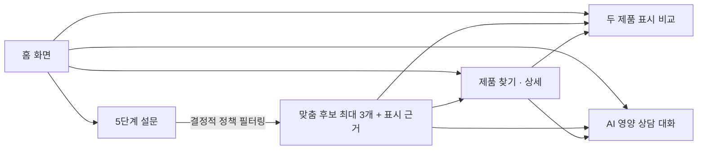

# 프로젝트 기획서 — 영양제 첫걸음 (VitaStep Guide)

> **문서 기준일**: 2026-10-24 (KST) · **구현 기준 커밋**: [`0bc17dc`](https://github.com/sayknow/M2-1/commit/0bc17dca34f3ec6479549248798e76bfcb962064) · **운영 브랜치**: `production`  
> **바로가기**: [운영 서비스](https://vitastep-guide.onrender.com/) · [최종 제출 문서 목차](final/README.md) · [기능 요구 명세서](functional-requirements.md) · [시스템 아키텍처](final/architecture.md) · [AI 활용 설계](final/ai-design.md)

**영양제 첫걸음**은 다이소 영양제를 처음 고르는 성인이 복잡한 제품 표시정보(성분·함량·기준량·섭취방법·주의사항)를 쉽게 이해하고, **5단계 설문 후보 추천 · 두 제품 표시 비교 · 출처 기반 AI 상담 대화**를 통해 스스로 제품을 탐색할 수 있도록 돕는 웹 서비스입니다.

---

## 1. 문제 정의 및 타깃 사용자

### 1.1 타깃 사용자
* **핵심 대상**: 영양제를 처음 구매하거나 제품의 영양·기능 표시를 읽는 데 어려움을 느끼는 **일반 성인(만 19세 이상)**
* **탐색 맥락**: 가격 부담이 적고 접근하기 쉬운 다이소 건강기능식품·일반식품으로 영양 관리를 시작하려 하지만, 무엇을 기준으로 골라야 할지 막막한 입문자

### 1.2 해결하고자 하는 핵심 문제 (기획 가설)
1. **초기 후보 탐색의 막막함**: 다이소 온라인몰 기준 건강 관련 상품이 80여 종에 달하고 비슷한 이름의 제품이 많아, 입문자가 자신의 관심 목적에 맞는 첫 후보를 추리기 어렵습니다.
2. **제품 표시정보 해독의 어려움**: 성분명, 1일 섭취량 기준, 함량 단위(`mg`, `μg`, `IU`), 영양성분 기준치(`%`) 등 표기 방식이 제품마다 달라 단순 숫자 크기만으로 제품을 오해하기 쉽습니다.
3. **제품 간 비교 및 중복 성분 확인의 번거로움**: 두 제품의 실질적인 표시 차이를 나란히 대조하거나, 현재 먹고 있는 제품과 기능성 성분이 겹치는지 개별 라벨을 일일이 찾아 계산하는 과정에 큰 부담이 있습니다.

> **문제 가설 및 서비스 목표의 경계**  
> 위 문제 정의는 팀이 설정한 **기획 가설**이며, 대상 인구의 규모나 건강 개선·만족도를 실증한 외부 통계 조사 결과를 주장하지 않습니다. 본 서비스의 목표는 의학적 진단·처방이 아니라, **구매 전 공식 표시정보 이해와 후보 탐색 과정을 돕는 것**입니다.

---

## 2. 해결 방식 및 사용자 흐름

### 2.1 전체 사용자 여정 (User Flow)

홈 화면에서 사용자의 탐색 목적에 따라 **`추천받기`**, **`제품 찾기`**, **`비교하기`**, **`AI에게 물어보기`**의 4가지 경로로 진입합니다.

* **처음 고르는 사용자**: `이용 동의` → `5단계 설문` → `후보 추천(최대 3개) 및 선정 근거 확인` → `제품 상세 · 두 제품 비교 · AI 대화`로 자연스럽게 이어집니다.
* **이미 제품을 아는 사용자**: 설문이나 동의 없이도 곧바로 `제품 찾기(87개 공개 카탈로그)` · `상세 표시정보` · `두 제품 표시 비교표`를 자유롭게 이용할 수 있습니다.

### 2.2 4대 핵심 경험 및 사용자 가치

| 핵심 경험 | 실제 구현 내용 | 사용자에게 제공하는 가치 |
|---|---|---|
| **1. 설문 후보 추천** | 관심 분야·기존 섭취 제품·주의조건·예산·제형을 바탕으로 **최대 3개 후보**와 표시 근거 제시 | 87개 전체 목록을 일일이 읽기 전에 내 조건에 맞는 탐색 범위를 빠르게 축소 |
| **2. 제품 찾기 · 상세** | 공식 썸네일 사진·관찰 가격·규격·성분·정량·섭취법·주의사항·공식 출처 URL 제공 | 제품마다 흩어져 있는 라벨 표시정보를 일관된 기준으로 한눈에 확인 |
| **3. 두 제품 비교** | 두 제품의 항목별 표시 비교표 제공 + 선택적 **AI 비교 차이 해설** 생성 | 섭취 기준량이나 단위가 다른 숫자를 단순 함량 우열로 오해하지 않도록 보조 |
| **4. AI 영양 상담 대화** | 공식 영양 지식 카드 및 검수 제품 DB 실시간 검색(RAG) + 출처 기반 답변 | 특정 제품을 고르기 전에도 낯선 표시 용어(`함량 vs 기준량`)나 일반 영양 정보를 쉽게 질문 |

### 2.3 UI/UX 설계 원칙
* **모바일 중심 반응형 구성**: 모바일 화면에서도 긴 라벨 정보를 부담 없이 읽을 수 있도록 핵심 요약을 먼저 보여주고 세부 원문은 펼침(`
`) 구조로 제공합니다.
* **친숙하고 명확한 시각 언어**: 다이소 상품 탐색 맥락에 어울리는 레드·화이트 톤앤매너를 적용하되, **다이소 공식·제휴 서비스가 아닌 학습용 프로젝트**임을 명확히 고지합니다.
* **투명한 상태 분리**: `정보 부족(insufficient)`, `추천 제한(restricted)`, `조건에 맞는 후보 없음(empty)`, `서버 기동 대기`, `외부 AI 호출 실패`를 서로 덮어쓰지 않고 구분해 안내합니다.

---

## 3. 서비스 범위 및 안전 경계

### 3.1 지원 관심 분야 (5대 분야)
설문 및 후보 분류에서 지원하는 관심 분야는 다음 **5가지(복수 선택 가능)**입니다:
1. **일상의 활력** (비타민 B군 등 에너지 생성·대사 관련 표시 중심)
2. **뼈·근육 건강** (칼슘, 마그네슘, 비타민 D 등 뼈·근육 기능 표시 중심)
3. **장 건강** (프로바이오틱스, 프리바이오틱스 등 장내 환경 관련 표시 중심)
4. **혈당 관리** (바나바잎 추출물 등 식후 혈당 상승 억제 관련 표시 중심 — *별도 범위 확인 필수*)
5. **다이어트** (가르시니아 캄보지아 등 체지방 감소 관련 표시 중심 — *별도 범위 확인 필수*)

### 3.2 포함 범위(In-Scope) vs 제외 범위(Out-of-Scope)

| 구분 | 세부 항목 |
|---|---|
| **포함 범위 (In-Scope)** | • **Must 핵심 기능 8개(`M01`~`M07`, `M09`)** 및 **Should 기능 1개(`S01` AI 비교 해설)** • 일반 성인의 제품 선택 보조 및 제품 라벨에 기재된 표시 섭취방법 안내 • 등록된 기존 섭취 제품(최대 10개)과의 기능성 성분 중복 확인 및 계산 가능한 1일 표시 합계 산출 • 코디세이 COPA `gpt-5.4` 기반 AI Agent 도구 호출 및 공식 근거 인용(RAG) |
| **제외 범위 (Out-of-Scope)** | • **의료 행위 일체**: 질환 진단·치료, 영양 결핍 판정, 개인별 복용량 처방, 의약품 병용 안전성 확정 • **초기 제외 구상**: 외부 쇼핑몰 상위 대안 제품 추천(`M08`), 눈 건강 추천, 실시간 가격·재고 연동 • **미사용 기술/기능**: 회원가입·로그인, 사용자 장기 메모리(Long-term Memory), 이미지 업로드 멀티모달 분석 |

### 3.3 안전 게이트 및 추천 제한 정책
* **민감 조건 즉시 제한**: 사용자가 `질환 진단·치료·의약품 복용 중`, `임신·수유 중`, `알레르기 확인 필요`를 선택하면 후보를 추천하지 않고(`restricted`) 전문가 상담을 안내합니다.
* **불확실한 입력의 보수적 처리**: 주의조건이나 기존 섭취 제품을 `잘 모르겠어요` 또는 `목록에 없어요`로 답한 경우, 임의로 '안전함'이나 '중복 없음'으로 간주하지 않고 `정보 부족(insufficient)`으로 안내합니다.
* **특화 분야 사전 확인**: `혈당 관리`와 `다이어트`는 질환 치료나 감량을 보장하지 않는다는 안내와 주의사항을 사용자가 직접 체크(`specialtyConfirmed`)해야만 후보를 탐색할 수 있습니다.

---

## 4. 데이터 확보 및 검수 품질

### 4.1 상품 데이터 수집 및 공개 현황

| 구분 | 수량 | 상세 설명 및 처리 기준 |
|---|---|---|
| **총 수집 상품** | **88개 SKU** | 다이소몰 공식 상품 상세 페이지 및 제조사 표시자료 기준 수집 |
| **공개 (검수 완료)** | **87개 SKU** | 성분·함량·섭취방법·주의사항 원문 대조 완료 (`verified` 상태만 서비스 노출) |
| **보류 (비공개)** | **1개 SKU** | 품번 `600651654` — 유산균 정량 표시를 원문에서 확인하지 못해 공개 및 추천 대상에서 제외 (`404` 처리) |
| **공식 썸네일 사진** | **88개 확보 / 87개 연결** | 전체 88개 썸네일 확보 후 공개 87개 제품 카드 및 상세 화면에 연결 완료 |
| **추천 목적 분류** | **28개 제품 / 40개 연결** | 5대 관심 분야에 대해 원문 기능성 표시가 검증된 직접(`direct`)·관련(`related`) 분류 매핑 |
| **일반 영양 지식 카드** | **35개 카드 / 12개 출처** | 주요 성분 10종 및 표시 읽기 개념에 대한 공식 자료(식약처, NIH ODS 등) 요약 카드 |

### 4.2 데이터 무결성 및 검수 원칙
* **이력 분리 보존**: 공식 라벨 원문, OCR 추출 텍스트, 검수 확정 값, 정정 이력(`correction_history`)을 SQLite 테이블별로 분리하고 원본 URL·파일 해시·관찰일을 보존합니다.
* **정량 표기 원문 유지**: 함량 수치, 단위(`mg`, `μg`, `IU` 등), 섭취 기준량(`1일 1정`, `총내용량 기준` 등), 등호/부등호(`=`, `<`)를 그대로 유지하며 **미확인 값을 임의로 `0`으로 바꾸지 않습니다.**
* **관찰 기준일 명시**: 가격·표시 주 관찰일은 `2026-10-19`, 라벨 검수는 `2026-10-19~20`, 썸네일 확인은 `2026-10-21`입니다. 동일 에이전트가 원문을 대조한 자체 검수 기록이며, 독립 제2검수나 임상 검증을 받은 자료가 아님을 명시합니다. (상세: [DB 설계 문서](product-database.md) · [라벨 검수 보고서](product-label-review.md))

---

## 5. 기술적 접근 및 스택 선정 이유

### 5.1 기술 스택 구성 및 선정 근거

| 영역 | 최종 선택 기술 | 선정 근거 및 아키텍처 의사결정 이유 |
|---|---|---|
| **프런트엔드** | **React · TypeScript · Vite** | 모바일 중심 단계형 설문·비교·채팅 UI를 빠르게 구성하고, 정적 사이트로 가볍게 배포하며 API 응답 타입을 엄격히 검증 |
| **백엔드** | **Python · FastAPI · Pydantic** | 데이터 수집·검수 스크립트와 동일한 Python 생태계를 재사용하고, 입력 스키마 검증과 비동기 AI 호출을 안정적으로 처리 |
| **데이터베이스** | **읽기 전용 SQLite + JSON** | 88개 SKU 규모의 정적 검수 데이터를 별도 외부 DB 서버 장애 위험 없이 Docker 이미지에 함께 묶어 일관되게 배포 |
| **추천 정책 엔진** | **결정적 서버 규칙 (`policy.py`)** | 후보 선정·주의조건 제한·성분 중복 계산을 서버 코드와 버전 관리 분류 JSON으로 고정하여, LLM의 임의 제품 추천이나 수치 왜곡 방지 |
| **AI Agent** | **OpenAI SDK → COPA `gpt-5.4`** | 코디세이 제공 API 게이트웨이(`copa.codyssey.kr`)와의 실제 인증 및 도구 호출(`tool_calls`) 호환성을 검증하여 적용 |
| **RAG 검색** | **SQLite · 공식 지식 동적 조회** | 고정 프롬프트 주입이 아니라, 질문 의도에 따라 제품 표시 DB·영양 지식 카드·표시 가이드를 실시간 조회해 출처 ID(`citationIds`) 강제 검증 |
| **배포 및 CI/CD** | **Render (정적 UI + Docker API) · GitHub Actions** | 소규모 운영 환경에서 프런트/백엔드를 분리 배포하고, 4개 자동화 검사(승격 방향·백엔드·프런트·데이터)로 품질 유지 |

### 5.2 핵심 AI 기술 요건 충족 (AI Agent + RAG)
* **과제 인정 핵심 기술**: **AI Agent**와 **RAG (검색 증강 생성)** 2가지를 핵심 기술로 구현했습니다.
* **의사결정 변경 이력**: 초기 프로토타입의 Gemini 연동 이후 코디세이 공식 제공 키(`COPA_API_KEY`)와 `gpt-5.4` 모델로 전환하며 실제 엔드포인트 제약(`tool_choice=auto`, 서버측 JSON 스키마·인용 검증)에 맞춰 에이전트 루프를 재설계했습니다. 초기 기획안의 Next.js·PostgreSQL·pgvector 구상은 88개 정량 검수 데이터의 정확한 키워드/필드 매칭 특성을 고려해 **경량 SQLite + 결정적 정책 + 질의별 동적 검색** 구조로 최적화했습니다. (상세: [AI 활용 설계](final/ai-design.md))

---

## 6. 팀 구성, 역할 분담 및 협업 전략

### 6.1 팀원 역할 배정 (5인)

| 팀원 | 배정 역할 | 주요 담당 책임 및 협업 범위 | 관련 산출물 위치 |
|---|---|---|---|
| **이승현** | **주 개발 · 통합/운영 관리** | 프런트·백엔드·AI 추천 공동 개발 주도, 전체 아키텍처 통합, CI/CD 및 `production` 승격·배포 관리 (`sayknow` 계정 확인) | [`App.tsx`](../frontend/src/App.tsx), [`main.py`](../backend/main.py), [`policy.py`](../backend/policy.py), [`agent.py`](../backend/agent.py), [`CONTRIBUTING.md`](../CONTRIBUTING.md) |
| **조준수** | **부 개발** | 주 개발자와 프런트·백엔드·AI 추천 공동 개발, 추천 목적 분류·AI 비교 해설·검색 도구 구현 및 회귀 테스트 보조 | [`App.tsx`](../frontend/src/App.tsx), [`classification.py`](../backend/classification.py), [`comparison.py`](../backend/comparison.py), [`backend/tests/`](../backend/tests/) |
| **김재욱** | **자료 수집 · 검수 · RAG 정리** | 공식 상품/제조사 출처 확인, 성분·단위·기준·섭취법·주의사항 검수, 보류 상품 관리, 일반 영양 지식 카드 및 검색 별칭 정리 | [DB 문서](product-database.md), [라벨 검수](product-label-review.md), [`nutrition-knowledge.json`](../backend/nutrition-knowledge.json) |
| **윤준서** | **기획 · 요구 명세 · 설계 문서** | 타깃/문제/서비스 범위 정의, Must 기능 요구사항 관리, 화면 이동 흐름 및 기술 선정 근거 문서화, 명세-구현 대조 | [기획서](project-plan.md), [기능 명세서](functional-requirements.md), [아키텍처](final/architecture.md) |
| **배창민** | **테스트 · 피드백 · 진행 문서** | Must 검증 시나리오 정리, 실사용자 5명 테스트 및 피드백 5대 개선 항목 정리, 테스트 결과·진행 이력·발표 구성안 취합 | [검증 결과](final/test-results.md), [사용자 피드백](final/user-feedback.md), [5인 응답 원본](final/evidence/user-test-records.md), [진행 기록](final/progress.md) |

> **[팀 협업 및 통합 배포 관리 방식]**: Render 클라우드 무중단 배포 및 브랜치(`canary → dev → production`) 승격의 안정성을 위해, 저장소의 최종 커밋 및 배포 관리는 주 개발자(이승현) 계정으로 통합·일원화하였습니다. 각 팀원(김재욱, 윤준서, 배창민, 조준수)은 자신의 전담 파트(라벨 데이터 검수, 기획/명세서 설계, 실사용자 QA, 공동 개발)를 독립적으로 수행한 후, 주 개발자를 통해 저장소에 통합 반영하였습니다. 팀원 5인 전원의 본인 기여 요약과 담당 산출물·커밋/PR 연결 내역은 [팀원 역할과 기여 문서](final/team-contributions.md)에 상세히 기록되어 있습니다.

### 6.2 Git 브랜치 및 승격 전략
* **`main`**: 초기 프로토타입 이력을 보존하는 기준 브랜치입니다.
* **`canary → dev → production` 단계적 승격**:
  1. `canary`: 기능 개발, 문서 정리 및 로컬 검증(`pytest`, 데이터 검증, 프런트 빌드) 수행
  2. `dev`: GitHub Actions CI 4개 검사 통과 후 통합 검증
  3. `production`: 주 관리자가 최종 확인 후 병합하며, Render 운영 서버에 자동 배포됩니다. (상세: [보안·운영 문서](final/security-and-operations.md))

---

## 7. 추진 일정 및 실제 진행 이력

| 일자 (2026년) | 주요 수행 작업 | 핵심 산출물 및 결과 |
|---|---|---|
| **10-19 ~ 10-20** | 다이소 공식 상품 자료 관찰·수집 및 라벨 표시 검수, 최초 프로토타입 코드 작성 | 88개 SKU 수집, 87개 공개 검수 DB 및 초기 화면 구현 |
| **10-21** | 공식 썸네일 사진 수집·연결, 백엔드 API·초기 AI 연동, 외부 배포 및 상담 지식 확장 | 87개 공개 썸네일 연결, 일반 영양 지식 카드(35개) 구축, 외부 접속 개시 |
| **10-22** | 서비스 도메인 식별성 개선 및 실사용자 테스트(`T1`·`T2`) 진행 | 운영 주소를 `vitastep-guide.onrender.com`으로 전환 |
| **10-23** | 브랜치 보호·CI 구축, 코디세이 COPA `gpt-5.4` 전환, 목적 분류·AI 비교 해설 추가 및 실사용자 테스트(`T3`~`T5`) | 운영 릴리스 커밋(`0bc17dc`) 배포 완료 및 라이브 API 검증 |
| **10-24** | 코드·운영 환경 전수 대조, 5인 피드백 원본·전원 기여 증빙·[발표 자료 PDF](presentation.pdf) 및 최종 제출 문서 체계 완성 | 최종 제출 문서 묶음([`docs/final/`](final/README.md)) 및 자동 무결성 검증 통과 |

*(초기 4주 단위 계획안은 실제 집중 수행 이력과 구분하여 [초기 기획서 아카이브](archive/project-plan-initial.md)에 보존했습니다.)*

---

## 8. 성공 기준 및 서비스 한계

### 8.1 과제 성공 기준 및 달성 현황
1. **핵심 기능 동작 (`G4`)**: Must 8개 기능이 실제 운영 API 3회 반복 검사에서 각각 2회 이상 기대 결과를 충족했습니다 (`M04` 2/3 성공, 나머지 7개 Must 및 `S01` 3/3 성공 — 상세: [검증 결과](final/test-results.md)).
2. **필수 기술 및 배포 (`G2`, `G3`)**: 외부 접속 가능한 Render 운영 환경에서 **AI Agent(7개 도구) + RAG(검수 DB/공식 지식 검색)**가 실제 `gpt-5.4` 모델로 동작함을 입증했습니다.
3. **실사용자 5명 피드백 반영 (`G5`)**: 팀원 제외 실제 타깃 성인 5명(`T1`~`T5`)의 테스트·익명화 응답 원본([`user-test-records.md`](final/evidence/user-test-records.md))과 이를 반영한 5대 핵심 개선(`F01`~`F05`, [`user-feedback.md`](final/user-feedback.md))을 완료했습니다.
4. **팀원 전원 기여 및 발표 자료 (`G6`, `G1`)**: 5인 전원의 본인 기여 요약과 담당 산출물·PR 연결([`team-contributions.md`](final/team-contributions.md)), 그리고 12페이지 서면 심사용 **[발표 자료 PDF (`docs/presentation.pdf`)](presentation.pdf)** 제작을 모두 완료했습니다.

### 8.2 서비스 및 기술적 한계
* **데이터 범위와 시점**: 다이소 일부 상품(공개 87개)에 한정된 정적 검수 데이터이며, 실시간 매장 재고나 가격 변동을 반영하지 않습니다.
* **외부 AI 의존성**: 코디세이 COPA 중계 서버 및 상위 LLM 제공자의 응답 지연·일시적 장애·호출 제한에 영향을 받을 수 있으며, 장애 시 규칙 기반 후보/비교표만 우선 제공하고 AI 영역은 실패 안내로 분리합니다.
* **비의료 보조 도구의 한계**: 키워드 기반 검색과 정규식/스키마 검증이 모든 자연어 의미 오류를 막지는 못하며, 어떠한 결과도 개인의 영양 결핍 진단이나 건강 개선 효과를 보증하지 않습니다.
